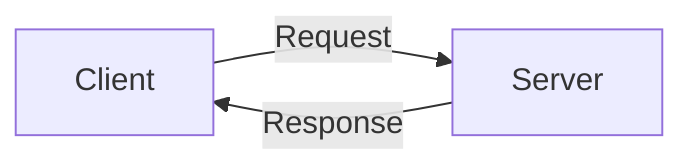
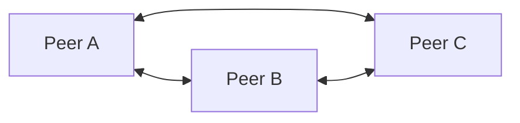
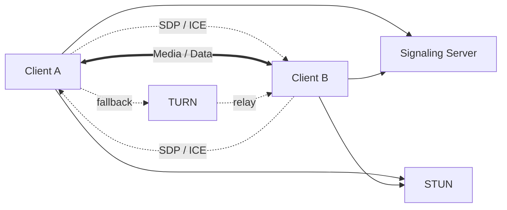

# Networking & Communication Protocols — SDE-2/SDE-3 Interview Master Notes

> **Goal:** Build strong protocol-selection intuition for Tier-1 SDE-2/SDE-3 interviews.
>
> You should be able to look at a requirement and answer:
>
> **What should I use? Why? What are the alternatives? What are the trade-offs? How does it work under the hood?**

---

## 0. The Mental Model

Do not memorize protocols independently. Think in layers:

```text
Application
   │
   │  "What does the application need?"
   ▼
Application Protocol
HTTP / gRPC / WebSocket / SMTP / IMAP / FTP / WebRTC
   │
   │
   ▼
Transport
TCP / UDP / QUIC
   │
   │
   ▼
Internet
IP
   │
   │
   ▼
Link / Network Access
Ethernet / Wi-Fi / Cellular
```

A useful interview mental model is:

```text
Business requirement
       │
       ▼
Communication pattern
       │
       ├── Request/Response ────────► HTTP / gRPC
       │
       ├── Server → Client stream ──► SSE / WebSocket
       │
       ├── Bidirectional realtime ──► WebSocket / WebRTC
       │
       ├── Media / P2P ─────────────► WebRTC
       │
       ├── File transfer ───────────► SFTP / HTTPS
       │
       └── Email ───────────────────► SMTP + IMAP/POP3
                │
                ▼
        Transport requirements
                │
                ├── Reliable + ordered ─► TCP
                ├── Low latency ────────► UDP
                └── HTTP/3 ─────────────► QUIC over UDP
```

---

# 1. Client–Server vs Peer-to-Peer

## Client–Server

A client requests a service from a server.



Examples:

- Browser → Web server
- Mobile app → REST API
- Microservice A → Microservice B
- Email client → Mail server

### Advantages

- Centralized control
- Easier authentication/authorization
- Easier data consistency
- Easier monitoring
- Easier business-rule enforcement

### Disadvantages

- Server can become bottleneck
- Server is a critical dependency
- Scaling requires infrastructure
- Network latency between client and server

---

## Peer-to-Peer

Peers communicate more directly with each other.



Examples:

- WebRTC media
- BitTorrent
- Some distributed systems

### Advantages

- Lower latency in some scenarios
- Can reduce server bandwidth
- Direct media transfer
- Better suited to some realtime use cases

### Disadvantages

- NAT traversal is difficult
- Security is more complicated
- Discovery/signaling is required
- Peer availability is unpredictable

### Important interview point

**WebRTC is peer-to-peer for media/data, but it normally still needs servers for signaling and often STUN/TURN infrastructure.**

---

# 2. Application Protocol Selection

## The first question: What communication pattern do I need?

| Requirement | Good starting choice |
|---|---|
| Standard API | HTTP/HTTPS |
| REST API | HTTP/HTTPS |
| Browser/server request-response | HTTP |
| Service-to-service RPC | gRPC |
| Browser receives continuous updates | SSE |
| Bidirectional realtime messaging | WebSocket |
| Video/audio calling | WebRTC |
| Email sending | SMTP |
| Email reading/sync | IMAP |
| Simple mail download | POP3 |
| Secure file transfer | SFTP / HTTPS |
| Legacy file transfer | FTP |
| Low-latency custom protocol | UDP |
| Reliable ordered byte stream | TCP |
| HTTP with modern transport | HTTP/3 + QUIC |

---

# 3. HTTP

HTTP is primarily a **request/response application-layer protocol**.

```text
Client
  │
  │ HTTP Request
  ▼
Server
  │
  │ HTTP Response
  ▼
Client
```

Example:

```http
GET /users/123 HTTP/1.1
Host: api.example.com
Authorization: Bearer <token>
```

Response:

```http
HTTP/1.1 200 OK
Content-Type: application/json

{
  "id": 123,
  "name": "Alice"
}
```

## Common methods

| Method | Purpose |
|---|---|
| GET | Retrieve resource |
| POST | Create/process |
| PUT | Replace resource |
| PATCH | Partial update |
| DELETE | Delete resource |
| HEAD | Headers only |
| OPTIONS | Discover supported operations |

---

## HTTP is stateless

The server does not inherently remember previous requests.

```text
Request 1 → Server
Request 2 → Server
Request 3 → Server
```

Each request contains the information needed to process it.

State can be introduced using:

- Cookies
- Sessions
- Tokens/JWT
- Server-side session stores
- External caches

### Why statelessness helps

- Easier horizontal scaling
- Any instance can process a request
- Easier load balancing
- Easier failover

---

# 4. HTTP Versions

## HTTP/1.0

Typically one TCP connection per request unless keep-alive is used.

## HTTP/1.1

Major improvements:

- Persistent connections
- Keep-alive
- Chunked transfer encoding
- Host header
- Better caching semantics

But HTTP/1.1 has a major limitation:

```text
One TCP connection
       │
       ├── Request A
       ├── Request B
       ├── Request C
       │
       └── Head-of-line blocking
```

---

## HTTP/2

HTTP/2 introduces **multiplexing**.

```text
One TCP connection
        │
        ├── Stream 1
        ├── Stream 3
        ├── Stream 5
        └── Stream 7
```

Multiple requests/responses can share one TCP connection.

Key features:

- Binary framing
- Multiplexing
- Header compression using HPACK
- Stream prioritization
- Persistent connections

### Important nuance

HTTP/2 removes HTTP-level request blocking between streams, but **TCP itself can still suffer head-of-line blocking** when packets are lost.

---

## HTTP/3

HTTP/3 runs over **QUIC**, which runs over UDP.

```text
HTTP/3
   │
 QUIC
   │
 UDP
   │
 IP
```

QUIC provides:

- Reliable delivery
- Encryption
- Multiplexed streams
- Faster connection establishment
- Better behavior under packet loss
- Connection migration

### Why QUIC?

TCP has connection-level head-of-line blocking.

QUIC gives independent streams:

```text
QUIC connection
 ├── Stream A ── lost packet
 ├── Stream B ── continues
 ├── Stream C ── continues
 └── Stream D ── continues
```

---

# 5. HTTP vs HTTPS

HTTPS = HTTP + TLS.

```text
HTTP
  +
TLS
  ↓
HTTPS
```

TLS provides:

- Encryption
- Integrity
- Server authentication

Typical flow:

```text
Client
  │
  │ TLS handshake
  ▼
Server
  │
  │ Encrypted HTTP
  ▼
```

### Interview answer

> HTTP defines the application communication semantics. TLS secures the communication channel. HTTPS is HTTP carried over TLS.

---

# 6. TCP

TCP is a **connection-oriented, reliable, ordered byte-stream transport protocol**.

```text
Application
    │
    ▼
   TCP
    │
    ▼
    IP
```

## What TCP provides

- Reliable delivery
- Ordered delivery
- Retransmission
- Flow control
- Congestion control
- Connection management

---

## TCP 3-Way Handshake

```text
Client                         Server

  SYN ------------------------>

      <------------------------ SYN + ACK

  ACK ------------------------>

        Connection established
```

Why three steps?

Both sides need to establish that:

1. Client can send
2. Server can receive and respond
3. Client can receive the response

---

## TCP is a byte stream

TCP does **not** preserve application message boundaries.

Suppose application sends:

```text
"HELLO"
"WORLD"
```

Receiver may read:

```text
"HELLOW"
"ORLD"
```

or:

```text
"HEL"
"LOWORLD"
```

Therefore, application protocols must define framing.

Examples:

- Length-prefix framing
- Delimiter-based framing
- Fixed-size messages

---

# 7. TCP Flow Control vs Congestion Control

These are commonly confused.

## Flow Control

Protects the **receiver**.

```text
Fast sender ─────────► Slow receiver
                    ↑
              receiver buffer
```

TCP uses a receive window.

Question:

> Can the receiver keep up?

---

## Congestion Control

Protects the **network**.

```text
Sender ───► Network ───► Receiver
             ↑
        congestion
```

Question:

> Can the network keep up?

---

# 8. UDP

UDP is a **connectionless datagram transport protocol**.

```text
Application
    │
    ▼
   UDP
    │
    ▼
    IP
```

UDP provides:

- Datagram-based communication
- Low overhead
- No connection handshake
- No guaranteed delivery
- No guaranteed ordering
- No retransmission by UDP itself

### Why use UDP?

When latency matters more than perfect delivery.

Examples:

- Live gaming
- Voice/video
- DNS
- QUIC
- Telemetry
- Some IoT systems

---

# 9. TCP vs UDP

| Feature | TCP | UDP |
|---|---|---|
| Connection | Connection-oriented | Connectionless |
| Reliability | Yes | No |
| Ordering | Yes | No |
| Retransmission | Yes | No |
| Flow control | Yes | No |
| Congestion control | Yes | No |
| Message boundaries | No | Yes |
| Overhead | Higher | Lower |
| Typical latency | Higher | Lower |
| Best for | Reliable data | Low-latency data |

### Decision rule

Use **TCP** when:

> "I must receive the data correctly and in order."

Use **UDP** when:

> "A late packet may be as bad as a lost packet."

---

# 10. TCP Does NOT Mean "Slow" and UDP Does NOT Mean "Fast"

This is an important interview correction.

UDP itself does not magically make an application fast.

Performance depends on:

- Network conditions
- Packet size
- Congestion
- Retransmission strategy
- Application protocol
- Serialization
- Server processing
- Connection setup

For example, **QUIC uses UDP but implements reliability, congestion control, encryption and streams at the transport layer.**

---

# 11. WebSocket

WebSocket provides a **persistent, full-duplex communication channel**.

```text
Client                         Server

      HTTP Upgrade request
  ---------------------------->

      101 Switching Protocols
  <----------------------------

       WebSocket connection

  <===========================>
      bidirectional messages
  <===========================>
```

After the handshake, the connection stays open.

## Good use cases

- Chat
- Live notifications
- Multiplayer games
- Trading dashboards
- Collaborative editing
- Realtime dashboards

### Example

```text
Client ───────► Server
        "send message"

Client ◄────── Server
        "new event"

Client ◄────── Server
        "notification"

Client ───────► Server
        "typing..."
```

---

# 12. WebSocket vs HTTP

| Requirement | HTTP | WebSocket |
|---|---|---|
| Request/response | Excellent | Possible |
| Server pushes data | Awkward | Excellent |
| Bidirectional realtime | No | Excellent |
| Stateless APIs | Excellent | Not ideal |
| Long-lived connection | Usually no | Yes |
| Simple CRUD | Excellent | Overkill |

### Rule

If the application mostly asks:

> "Give me this data."

Use HTTP.

If the requirement is:

> "Keep this connection open and let both sides send events whenever needed."

Use WebSocket.

---

# 13. SSE — Server-Sent Events

SSE allows the server to continuously send events to a browser over HTTP.

```text
Client ───── HTTP request ─────► Server

Client ◄──── event 1 ─────────── Server
Client ◄──── event 2 ─────────── Server
Client ◄──── event 3 ─────────── Server
Client ◄──── event 4 ─────────── Server
```

It is **unidirectional**:

```text
Server ─────────────► Client
```

### Use SSE when

- Server is the primary producer
- Client mostly receives events
- Browser compatibility is important
- You want simpler infrastructure than WebSocket

Examples:

- AI token streaming
- Job progress
- Notifications
- Live feeds

### SSE vs WebSocket

| | SSE | WebSocket |
|---|---|---|
| Direction | Server → Client | Bidirectional |
| Runs over HTTP | Yes | Starts with HTTP upgrade |
| Reconnection | Built-in browser support | Usually application-managed |
| Simple streaming | Excellent | Good |
| Chat | Limited | Excellent |

---

# 14. FTP

FTP = File Transfer Protocol.

Traditional FTP commonly uses:

```text
Control connection → TCP 21
Data connection    → separate connection
```

The important idea:

> FTP separates control traffic from data transfer.

### Problems with traditional FTP

- Credentials/data are not encrypted by default
- Firewall/NAT handling can be complicated
- Multiple connections
- Legacy operational complexity

### Prefer today

For secure file transfer:

- **SFTP** — SSH File Transfer Protocol
- **HTTPS** — file upload/download
- Cloud object storage APIs

### Important interview trap

**SFTP is not "secure FTP".**

SFTP is a different protocol that runs over SSH.

---

# 15. SMTP

SMTP = Simple Mail Transfer Protocol.

Its primary purpose is **sending/relaying email**.

```text
Mail Client
    │
    │ SMTP
    ▼
Mail Server
    │
    │ SMTP
    ▼
Recipient Mail Server
```

Think:

> **SMTP = send/relay mail**

Commonly associated ports:

- 25 — server-to-server SMTP
- 587 — mail submission
- 465 — SMTP over implicit TLS

---

# 16. IMAP

IMAP is used by clients to **access and synchronize email stored on a mail server**.

```text
Mail Server
    │
    │ IMAP
    ▼
Email Client
```

IMAP keeps mail on the server and synchronizes state.

Examples:

- Read/unread state
- Folders
- Flags
- Messages

### Think

```text
SMTP → Send mail
IMAP → Read/synchronize mail
POP3 → Download mail
```

---

# 17. SMTP vs IMAP vs POP3

| Protocol | Primary job |
|---|---|
| SMTP | Send/relay email |
| IMAP | Read + synchronize email |
| POP3 | Download email |

Modern multi-device email clients generally favor **IMAP** because server-side synchronization is important.

---

# 18. WebRTC

WebRTC enables realtime peer-to-peer communication in browsers/apps.

Typical use cases:

- Video calls
- Audio calls
- Screen sharing
- P2P data channels
- Low-latency realtime communication



---

# 19. WebRTC Architecture

WebRTC normally involves three concepts:

## 1. Signaling

Used to exchange connection metadata.

Examples:

- SDP
- ICE candidates

Signaling is **not defined as a single mandatory protocol by WebRTC**.

You can implement signaling using:

- WebSocket
- HTTP
- Any suitable mechanism

---

## 2. STUN

STUN helps a peer discover its public-facing network address.

```text
Private IP
    │
    ▼
NAT
    │
    ▼
Internet
    │
    ▼
STUN Server
```

Think:

> "What public address does the outside world see for me?"

---

## 3. TURN

If direct peer-to-peer communication cannot be established, TURN relays traffic.

```text
Client A
    │
    ▼
 TURN Server
    │
    ▼
Client B
```

TURN costs more because the media/data passes through your infrastructure.

### Key rule

```text
Try direct P2P first
        │
        ├── works ──► Direct communication
        │
        └── fails ──► TURN relay
```

---

# 20. WebRTC vs WebSocket

This distinction is extremely important.

| | WebSocket | WebRTC |
|---|---|---|
| Main model | Client ↔ Server | Peer ↔ Peer |
| Realtime | Yes | Yes |
| Video/audio | Not ideal | Excellent |
| Server bandwidth | High for relayed data | Can be lower |
| Browser support | Excellent | Excellent |
| Signaling | WebSocket can be used | Required somehow |
| NAT traversal | Not its purpose | STUN/TURN/ICE |
| Typical use | Chat/events | Calls/media |

### Simple rule

> **WebSocket = realtime application communication with a server.**

> **WebRTC = realtime peer-to-peer media/data communication.**

---

# 21. DNS — The Missing Foundation

Before HTTP can normally happen, the client needs to resolve a hostname.

```text
https://api.example.com
        │
        ▼
       DNS
        │
        ▼
   203.0.113.10
        │
        ▼
      Server
```

DNS maps names to network addresses and other records.

Common records:

| Record | Purpose |
|---|---|
| A | Domain → IPv4 |
| AAAA | Domain → IPv6 |
| CNAME | Alias |
| MX | Mail server |
| TXT | Text/verification/policy |
| NS | Authoritative nameserver |

---

# 22. End-to-End: What Happens When You Open a Website?

Suppose you open:

```text
https://example.com
```

Simplified flow:

```text
1. DNS resolution
       ↓
2. Find server IP
       ↓
3. Establish transport
       ↓
4. TLS handshake
       ↓
5. HTTP request
       ↓
6. Server processing
       ↓
7. HTTP response
       ↓
8. Browser renders page
```

For HTTP/1.1 or HTTP/2:

```text
Application: HTTP
       ↓
Security: TLS
       ↓
Transport: TCP
       ↓
Network: IP
```

For HTTP/3:

```text
Application: HTTP/3
       ↓
Transport/security: QUIC
       ↓
Network: IP
```

---

# 23. A Better Protocol Decision Framework

When designing a system, ask these questions **in order**.

## Question 1 — Who talks to whom?

```text
Client → Server
Peer   ↔ Peer
Service → Service
Server → Client
```

---

## Question 2 — Is communication synchronous or asynchronous?

### Synchronous

```text
A ──request──► B
A ◄─response── B
```

Examples:

- HTTP
- gRPC

### Asynchronous

```text
A ──event──► Queue/Broker
                    │
                    ▼
                    B
```

Examples:

- Kafka
- RabbitMQ
- SQS

> Do not confuse an application protocol with a messaging architecture. HTTP/WebSocket/gRPC solve communication; Kafka/RabbitMQ/SQS solve asynchronous messaging and buffering patterns.

---

## Question 3 — Is the traffic request/response or streaming?

```text
Request/Response → HTTP / gRPC

Server streaming → SSE / gRPC streaming

Bidirectional stream → WebSocket / WebRTC / gRPC bidirectional streaming
```

---

## Question 4 — Do I need reliable ordered delivery?

```text
YES → TCP / QUIC
NO  → UDP may be appropriate
```

But remember:

> QUIC itself provides reliability while using UDP underneath.

---

## Question 5 — Does latency matter more than completeness?

Example:

### Video call

If packet #100 is lost:

```text
Old frame arrives 2 seconds later
```

It may be useless.

Better:

```text
Drop old packet
Continue with newer frame
```

This is why UDP-based approaches are valuable for realtime media.

---

# 24. Protocol Selection Cheat Sheet

```text
                     START
                       │
                       ▼
             What are you building?
                       │
       ┌───────────────┼────────────────┐
       ▼               ▼                ▼
      API            Realtime          Email
       │               │                │
       ▼               │          ┌─────┴─────┐
 HTTP/gRPC             │          ▼           ▼
                       │        Send        Read
                       │          │           │
                       │        SMTP       IMAP
                       │
              ┌────────┴─────────┐
              ▼                  ▼
          Server push       Bidirectional
              │                  │
             SSE             WebSocket
                                 │
                                 │
                           Media / P2P?
                                 │
                                YES
                                 │
                              WebRTC
```

---

# 25. Practical Technology Selection

## Scenario 1 — E-commerce REST API

Requirement:

- Mobile/web clients
- CRUD
- Authentication
- Stateless services
- JSON

### Choice

**HTTPS REST**

Why?

- Universal
- Simple
- Cacheable
- Easy to debug
- Excellent tooling

---

## Scenario 2 — Microservice-to-microservice low-latency API

Requirement:

- Strong contracts
- High performance
- Internal services
- Streaming may be useful

### Choice

**gRPC**

Why?

- HTTP/2
- Protobuf
- Strongly typed contracts
- Efficient serialization
- Streaming support

But REST/HTTP may still be better when:

- Public API
- Browser clients
- Human debugging
- Broad ecosystem compatibility

---

## Scenario 3 — Chat application

Requirement:

- User sends messages
- Server pushes messages instantly
- Bidirectional realtime communication

### Choice

**WebSocket**

```text
User A
  │
  │ WebSocket
  ▼
Chat Server
  │
  │ WebSocket
  ▼
User B
```

---

## Scenario 4 — Live dashboard

Requirement:

- Server continuously publishes updates
- Client rarely sends data

### Choice

**SSE**

Because communication is mostly:

```text
Server ─────────► Browser
```

WebSocket would work but may be unnecessary.

---

## Scenario 5 — Video calling

Requirement:

- Audio/video
- Low latency
- Peer-to-peer preferred

### Choice

**WebRTC**

Use:

- Signaling server
- STUN
- TURN fallback

---

## Scenario 6 — Upload a 5 GB file

Possible choices:

### HTTPS

Good default.

```text
Client ──HTTPS multipart/upload──► Object Storage
```

Use:

- Multipart uploads
- Resumability
- Checksums
- Presigned URLs

### SFTP

Good when the integration specifically requires SSH-based file transfer.

### FTP

Usually avoid for new secure systems unless a legacy partner requires it.

---

# 26. Common Interview Traps

## Trap 1

> "UDP is unreliable, therefore it cannot be used for reliable systems."

Wrong.

QUIC provides reliability over UDP.

---

## Trap 2

> "WebSocket is a transport protocol."

Wrong.

WebSocket is an **application-layer protocol**.

It commonly uses TCP underneath.

---

## Trap 3

> "HTTP/2 completely eliminates head-of-line blocking."

Wrong.

HTTP/2 multiplexes streams, but TCP packet loss can still block delivery at the TCP layer.

HTTP/3 + QUIC addresses this more effectively using independent streams.

---

## Trap 4

> "SFTP is secure FTP."

Not technically correct.

SFTP is a separate file-transfer protocol built over SSH.

---

## Trap 5

> "WebRTC means no servers."

Wrong.

You may still need:

- Signaling server
- STUN server
- TURN server

---

## Trap 6

> "TCP sends messages."

TCP sends an **ordered byte stream**.

Application-level messages require framing.

---

# 27. Protocol Stack — Quick Revision

## Traditional HTTPS

```text
┌─────────────────────┐
│       HTTP          │ Application
├─────────────────────┤
│       TLS           │ Security
├─────────────────────┤
│       TCP           │ Transport
├─────────────────────┤
│       IP            │ Network
├─────────────────────┤
│ Ethernet / Wi-Fi    │ Link
└─────────────────────┘
```

## HTTP/3

```text
┌─────────────────────┐
│      HTTP/3         │
├─────────────────────┤
│       QUIC          │ Transport + Security
├─────────────────────┤
│       UDP           │
├─────────────────────┤
│       IP            │
└─────────────────────┘
```

---

# 28. Reliability Spectrum

Think of protocols as a design spectrum.

```text
More application control
        │
        ▼
UDP ───────────────► QUIC ─────────────► TCP
 │                     │                   │
 │                     │                   │
Fast/custom         Reliable +          Reliable +
behavior            multiplexed         ordered byte stream
```

The correct choice depends on the application.

---

# 29. Latency vs Reliability

A useful mental model:

```text
                    Reliability
                        ▲
                        │
                        │       TCP
                        │
                        │            QUIC
                        │
                        │
                        │
                        │ UDP
                        └────────────────────►
                              Low latency
```

This is intentionally simplified.

Real-world performance depends heavily on network conditions and implementation.

---

# 30. Protocol vs Architecture vs Infrastructure

Do not mix these concepts.

### Protocol

Defines communication rules.

Examples:

- HTTP
- TCP
- UDP
- SMTP
- WebSocket

### Architecture

Defines how components interact.

Examples:

- Client-server
- Peer-to-peer
- Event-driven
- Request-response

### Infrastructure

Provides the runtime environment.

Examples:

- Load balancer
- CDN
- API Gateway
- NAT
- Proxy
- Service mesh

### Example

A production API might look like:

```text
Browser
   │
 HTTPS
   ▼
CDN / Load Balancer
   │
 HTTPS
   ▼
API Gateway
   │
 HTTP/gRPC
   ▼
Microservice
   │
 Kafka
   ▼
Async Consumers
```

---

# 31. Real-World System Design Example

## Ride-sharing application

Different requirements can use different protocols.

```text
                    ┌───────────────┐
                    │ Mobile Client │
                    └───────┬───────┘
                            │
                 HTTPS / WebSocket
                            │
                            ▼
                    ┌───────────────┐
                    │ API Gateway   │
                    └───────┬───────┘
                            │
                       HTTP/gRPC
                            │
             ┌──────────────┼──────────────┐
             ▼              ▼              ▼
        User Service   Trip Service   Driver Service
             │              │              │
             └──────────────┼──────────────┘
                            │
                          Kafka
                            │
                            ▼
                     Async Consumers
```

For a driver location update:

- Mobile → server: WebSocket/HTTP depending on design
- Server → mobile: WebSocket for realtime updates
- Async processing: Kafka
- API calls: HTTP/gRPC
- Storage: database/cache

**One system can use multiple protocols.**

---

# 32. How to Answer "Why Did You Choose X?"

Use this structure:

```text
Requirement
    ↓
Communication pattern
    ↓
Protocol
    ↓
Why it fits
    ↓
Alternatives
    ↓
Trade-offs
```

### Example

> "We chose WebSocket because the requirement was bidirectional realtime communication between clients and the server. HTTP polling would introduce unnecessary latency and request overhead. SSE would simplify server-to-client streaming but does not provide the bidirectional communication we needed. WebSocket gives us a persistent full-duplex channel, at the cost of connection management and infrastructure complexity."

This style is much stronger than:

> "We used WebSocket because it is fast."

---

# 33. Interview Decision Matrix

| Requirement | Primary choice | Alternative | Main trade-off |
|---|---|---|---|
| Public REST API | HTTPS | gRPC | Simplicity vs efficiency |
| Internal RPC | gRPC | HTTP REST | Efficiency vs universal compatibility |
| Browser streaming | SSE | WebSocket | Simplicity vs bidirectionality |
| Realtime chat | WebSocket | SSE + HTTP | Persistent connections |
| Video call | WebRTC | WebSocket/media server | Complexity vs P2P |
| Secure file transfer | SFTP/HTTPS | FTP | Compatibility vs security |
| Email sending | SMTP | Provider API | Standard protocol vs provider features |
| Email synchronization | IMAP | POP3 | Rich sync vs simple download |
| Reliable stream | TCP | QUIC | Stream semantics vs multiplexing |
| Low-latency datagrams | UDP | QUIC | Application responsibility vs reliability |

---

# 34. Senior-Level Trade-offs to Discuss

At SDE-2/SDE-3 level, don't stop at protocol features.

Discuss:

### Scalability

- Number of connections
- Connection lifetime
- Connection state
- Load balancing
- Horizontal scaling

### Reliability

- Retries
- Timeouts
- Backpressure
- Circuit breakers
- Connection recovery

### Security

- TLS
- Authentication
- Authorization
- Certificate validation
- Replay protection
- Rate limiting

### Performance

- Latency
- Throughput
- Serialization
- Compression
- Connection reuse

### Operations

- Observability
- Metrics
- Logging
- Tracing
- Debuggability

---

# 35. Persistent Connections and Scaling

Protocols such as WebSocket create long-lived connections.

Suppose:

```text
1,000,000 connected users
```

You cannot think only about:

```text
requests/sec
```

You must also consider:

```text
concurrent connections
file descriptors
memory per connection
load balancer limits
connection distribution
connection draining
reconnection storms
```

### Reconnection storm

If a service restarts:

```text
1M clients
     │
     │ reconnect simultaneously
     ▼
Load Balancer
     │
     ▼
Servers overloaded
```

This can become a cascading failure.

Solutions:

- Exponential backoff
- Jitter
- Connection limits
- Load shedding
- Graceful shutdown
- Health-aware routing

---

# 36. Backpressure

Suppose:

```text
Producer: 100,000 events/sec
Consumer: 10,000 events/sec
```

Without backpressure:

```text
Buffer
████████████████████████████████
            grows
```

Eventually:

- Memory increases
- Latency increases
- System crashes

Backpressure mechanisms include:

- Bounded queues
- TCP flow control
- Consumer pull models
- Rate limiting
- Dropping stale realtime data
- Kafka consumer lag management

---

# 37. Realtime Systems: Don't Treat Every Message Equally

For realtime media:

```text
Old frame ──X──► discard
New frame ─────► process
```

For financial transaction:

```text
Old transaction ──X──► cannot discard
```

Therefore:

> Protocol choice depends on the business semantics of data loss.

This is one of the most important system-design insights.

---

# 38. Quick Revision — One Page

```text
HTTP
→ Request/response
→ APIs
→ Stateless by default

TCP
→ Reliable
→ Ordered
→ Byte stream
→ Flow + congestion control

UDP
→ Datagram
→ No built-in reliability/order
→ Low overhead
→ Useful for realtime/latency-sensitive workloads

QUIC
→ Runs over UDP
→ Reliable
→ Multiplexed streams
→ Encryption integrated
→ Used by HTTP/3

WebSocket
→ Persistent
→ Full duplex
→ Client ↔ Server
→ Realtime applications

SSE
→ Persistent HTTP stream
→ Server → Client
→ Simple realtime updates

WebRTC
→ Peer-to-peer media/data
→ STUN/TURN/ICE
→ Signaling required

FTP
→ File transfer
→ Legacy/insecure by default

SFTP
→ File transfer over SSH

SMTP
→ Send/relay email

IMAP
→ Read/synchronize email

POP3
→ Download email

DNS
→ Name → IP / service information

TLS
→ Encryption + integrity + authentication
```

---

# 39. Final Protocol Selection Checklist

Before choosing a protocol in a system-design interview, explicitly answer:

- [ ] Who are the communicating parties?
- [ ] Client-server or peer-to-peer?
- [ ] Request/response or streaming?
- [ ] One-way or bidirectional?
- [ ] Realtime requirement?
- [ ] Reliable delivery required?
- [ ] Ordered delivery required?
- [ ] Can packets/messages be dropped?
- [ ] Does the application need message boundaries?
- [ ] Browser compatibility required?
- [ ] Public API or internal service?
- [ ] Connection-oriented or datagram-oriented?
- [ ] Expected concurrent connections?
- [ ] Expected QPS/throughput?
- [ ] Security requirements?
- [ ] Authentication mechanism?
- [ ] How will reconnection work?
- [ ] How will backpressure work?
- [ ] How will the system scale horizontally?
- [ ] What happens when the network fails?
- [ ] What is the fallback protocol?
- [ ] What is the operational/debugging cost?

---

# 40. The Golden Rule

> **Don't choose a protocol because it is popular. Choose it because its communication semantics match the business requirement.**

The strongest SDE-2/SDE-3 answer is rarely:

> "Use WebSocket."

It is:

> "The requirement is bidirectional, low-latency communication with long-lived connections. HTTP polling creates unnecessary request overhead, while SSE only supports server-to-client streaming. Therefore WebSocket is the better fit. The trade-off is connection management, horizontal scaling, reconnection handling, and potentially higher infrastructure complexity."

That is the level of reasoning expected in strong system-design interviews.

---

## Further Topics to Add to This Networking Track

After mastering this README, the natural next layer is:

1. DNS deep dive
2. TLS / HTTPS handshake
3. HTTP/1.1 vs HTTP/2 vs HTTP/3 packet-level flow
4. TCP internals and congestion control
5. UDP + QUIC
6. Load balancers and reverse proxies
7. CDN
8. Long polling vs SSE vs WebSocket
9. gRPC and HTTP/2
10. RPC vs REST
11. NAT, STUN, TURN and ICE
12. Network failure modes
13. Timeouts, retries and exponential backoff
14. Connection pooling
15. Service mesh
16. API Gateway
17. Message brokers and event-driven communication
18. Network observability: latency, packet loss, throughput and tracing

These topics together form the networking foundation needed for advanced distributed-system and system-design interviews.
