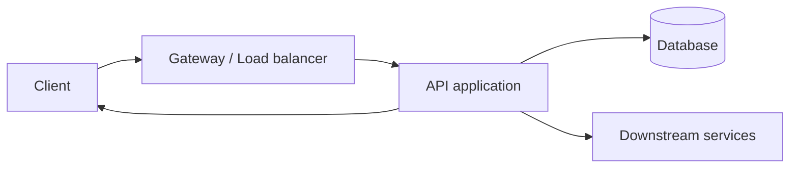
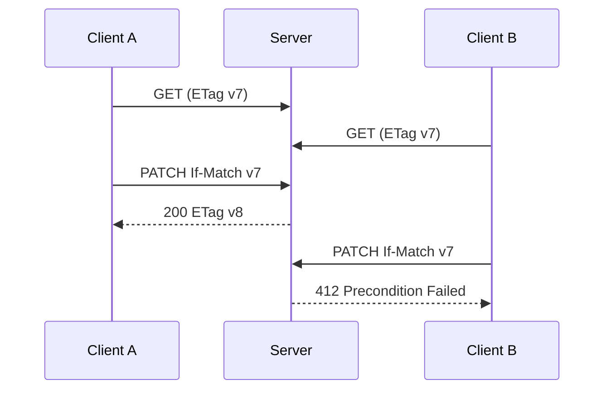
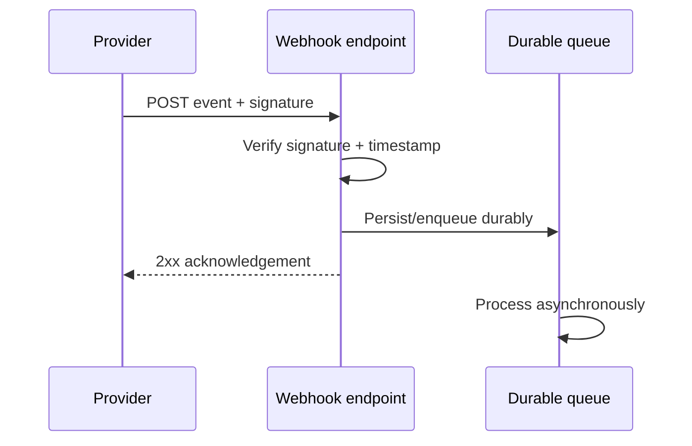

# REST API Mastery — Senior Software Engineer / SDE-2 / SDE-3

> A production-oriented, interview-ready reference covering REST/HTTP semantics, API design, security, reliability, scalability, OpenAPI, and implementation in ASP.NET Core, NestJS and Spring Boot.

## 1. The mental model

REST is an **architectural style**, not a framework, language, JSON format, or synonym for HTTP. A REST API exposes resources through representations and a uniform interface. HTTP is the most common protocol used to implement it.



A senior engineer designs a long-lived contract: predictable, secure, evolvable, observable and safe under partial failure.

## 2. REST constraints

1. **Client–server:** UI and data concerns are separated.
2. **Stateless:** Each request contains the context needed to understand it; no hidden conversational client state is required.
3. **Cacheable:** Responses define whether and how they can be cached.
4. **Uniform interface:** Resource identification, manipulation through representations, self-descriptive messages and hypermedia controls.
5. **Layered system:** Clients need not know whether they talk to an origin, proxy or gateway.
6. **Code-on-demand (optional):** Server may send executable code.

Stateless does not mean the server stores no data. Users, orders, sessions, refresh-token families, caches, rate counters and workflow state may all be persisted. It means a request does not depend on hidden conversational state from a previous request.

Many practical APIs are REST-like: resource-oriented HTTP + JSON, without full hypermedia. Be accurate about the distinction but don't get stuck in terminology.

## 3. Resource-oriented design

Prefer nouns and stable identifiers:

```http
GET    /v1/orders
GET    /v1/orders/ord_123
POST   /v1/orders
PUT    /v1/orders/ord_123
PATCH  /v1/orders/ord_123
DELETE /v1/orders/ord_123
```

Avoid making every endpoint an RPC verb (`/getOrder`, `/createOrder`). Domain actions that do not map naturally to CRUD can be modeled as explicit command/subresources:

```http
POST /v1/orders/ord_123/cancellation
POST /v1/orders/ord_123/claims
```

Good URI practices:
- Use plural collection nouns consistently.
- Use stable public IDs, not database implementation details.
- Use query parameters for filtering, sorting, pagination and optional selection.
- Avoid deeply nested paths when they create fragile coupling.
- Never put credentials or sensitive personal data in URLs.
- Keep resource identifiers independent of mutable business state.

```mermaid
flowchart TD
 O[/orders] --> O1[/orders/ord_123]
 O1 --> I[/orders/ord_123/items]
 I --> I1[/orders/ord_123/items/item_9]
```

## 4. HTTP request and response anatomy

```http
PATCH /v1/orders/ord_123 HTTP/1.1
Host: api.example.com
Authorization: Bearer <access-token>
Content-Type: application/merge-patch+json
Accept: application/json
If-Match: "v7"
X-Request-Id: req_abc

{ "deliveryNote": "Leave at reception" }
```

```http
HTTP/1.1 200 OK
Content-Type: application/json
ETag: "v8"
Cache-Control: private, max-age=30

{ "id": "ord_123", "status": "confirmed", "version": 8 }
```

Useful headers:

| Header | Meaning |
|---|---|
| `Accept` | Response media types client accepts |
| `Content-Type` | Request/response body media type |
| `Authorization` | Credentials |
| `Cache-Control` | Caching rules |
| `ETag` | Representation validator |
| `If-None-Match` | Conditional cache validation |
| `If-Match` | Conditional mutation / optimistic concurrency |
| `Location` | Created resource or redirect URI |
| `Retry-After` | Suggested retry delay |
| `Traceparent` | W3C distributed trace context |
| `Accept-Language` | Preferred human language |

`Idempotency-Key` is a widely used application convention, not a universal HTTP method guarantee. Document its scope, retention and replay semantics.

## 5. HTTP methods: safety and idempotency

| Method | Typical use | Safe? | Idempotent? |
|---|---|---:|---:|
| GET | Retrieve | Yes | Yes |
| HEAD | GET metadata, no response body | Yes | Yes |
| POST | Create/process/submit | No | Not inherently |
| PUT | Create/replace target state | No | Yes |
| PATCH | Apply patch document | No | Depends |
| DELETE | Remove target association/state | No | Yes |
| OPTIONS | Discover options | Yes | Yes |
| TRACE | Diagnostic loopback; often disabled | Yes | Yes |

**Safe** means intended to be read-only from the client's perspective. Logging/metrics are incidental effects; a GET must not perform a business mutation.

**Idempotent** means repeating an identical request has the same intended effect as one request. It does not mean identical responses. A repeated DELETE may return 404 after the first returned 204 while the intended state remains “resource absent”.

### GET
- Safe and idempotent; often cacheable when policy permits.
- Never use GET for business side effects.
- Avoid sensitive query parameters because URLs can be logged, stored in history and sent in referrers.

### POST
- Commonly creates a subordinate resource or submits a command.
- Not inherently idempotent.
- For payments/order creation, use a documented idempotency mechanism because a timeout does not prove the server failed.

### PUT vs PATCH
PUT replaces the target resource state according to the API contract and is idempotent. PATCH applies a patch document and is not inherently idempotent.

JSON Merge Patch:

```http
PATCH /v1/users/42
Content-Type: application/merge-patch+json

{ "name": "Asha" }
```

JSON Patch:

```http
PATCH /v1/users/42
Content-Type: application/json-patch+json

[
  { "op": "replace", "path": "/name", "value": "Asha" },
  { "op": "add", "path": "/tags/-", "value": "priority" }
]
```

PATCH pitfalls:
- Define omitted-field and `null` semantics.
- Whitelist patchable properties.
- Validate the resulting resource and business invariants.
- Prevent lost updates with ETag/If-Match or version checks.
- Appending to an array is not naturally idempotent.

### DELETE
Idempotent in intended effect. Decide whether repeated deletion returns 204, 404 or another documented result. Soft deletion and retention may mean data is not physically erased immediately.

## 6. Status codes

### Success

| Code | Meaning | Use |
|---|---|---|
| 200 | OK | Completed; representation returned |
| 201 | Created | Resource created; normally include `Location` |
| 202 | Accepted | Accepted for async processing, not completed |
| 204 | No Content | Success, intentionally no body |
| 206 | Partial Content | Range response |

Async report example:

```http
POST /v1/reports
HTTP/1.1 202 Accepted
Location: /v1/operations/op_789
Retry-After: 3
```

Client polls `GET /v1/operations/op_789` or receives a callback/event.

### Redirection

| Code | Meaning | Important detail |
|---|---|---|
| 301 | Moved Permanently | Permanent; historical clients may rewrite POST |
| 302 | Found | Temporary; historical method rewriting |
| 303 | See Other | Follow with GET |
| 304 | Not Modified | Conditional GET/HEAD; no body |
| 307 | Temporary Redirect | Preserve method and body |
| 308 | Permanent Redirect | Preserve method and body |

### Client errors

| Code | Meaning | Use |
|---|---|---|
| 400 | Bad Request | Malformed/invalid request |
| 401 | Unauthorized | Missing/invalid authentication; normally `WWW-Authenticate` |
| 403 | Forbidden | Caller lacks permission |
| 404 | Not Found | Missing or deliberately concealed resource |
| 405 | Method Not Allowed | Include `Allow` |
| 406 | Not Acceptable | No acceptable response representation |
| 409 | Conflict | Business/current-state conflict |
| 410 | Gone | Intentionally and permanently unavailable |
| 412 | Precondition Failed | `If-Match` or another precondition failed |
| 413 | Content Too Large | Body exceeds limit |
| 415 | Unsupported Media Type | Unsupported request content type |
| 422 | Unprocessable Content | Syntax understood, semantic content invalid |
| 429 | Too Many Requests | Rate limited; often `Retry-After` |

### Server errors

| Code | Meaning |
|---|---|
| 500 | Unexpected internal failure |
| 501 | Functionality/method not implemented |
| 502 | Gateway got invalid upstream response |
| 503 | Temporarily unavailable/overloaded/maintenance |
| 504 | Gateway timed out waiting for upstream |

Tricky distinctions:
- **401 vs 403:** authentication absent/invalid vs permission denied. 404 may deliberately conceal existence.
- **400 vs 422:** malformed/invalid request vs syntactically understood but semantically unprocessable; define consistent team convention.
- **409 vs 412:** business/state conflict vs explicit HTTP precondition failure.
- **200 vs 202:** completed vs accepted for later processing.
- **502 vs 503 vs 504:** invalid upstream response vs unavailable service vs upstream timeout.

## 7. Complete order API example

Create:

```http
POST /v1/orders
Authorization: Bearer <token>
Content-Type: application/json
Idempotency-Key: 7d7c...

{
  "customerId": "cust_42",
  "items": [{ "sku": "sku_100", "quantity": 2 }],
  "shippingAddressId": "addr_8"
}
```

```http
HTTP/1.1 201 Created
Location: /v1/orders/ord_900
ETag: "1"
Content-Type: application/json

{
  "id": "ord_900",
  "status": "pending",
  "total": { "amount": "1299.00", "currency": "INR" },
  "createdAt": "2026-11-05T10:00:00Z",
  "version": 1
}
```

Why good: stable resource URI, server-generated ID, correct 201 + Location, explicit currency, ETag for concurrency and idempotency key for retry safety. Use decimal/money types, not binary floating-point, for monetary arithmetic.

Retrieve:

```http
GET /v1/orders/ord_900
If-None-Match: "1"
```

Unchanged response: `304 Not Modified`, with the current ETag.

Conditional update:

```http
PATCH /v1/orders/ord_900
If-Match: "1"
Content-Type: application/merge-patch+json

{ "deliveryNote": "Call on arrival" }
```

Success advances ETag to `"2"`. A stale ETag gets `412 Precondition Failed`.

## 8. Pagination, filtering and sorting

Never return an unbounded collection.

### Offset pagination

```http
GET /v1/orders?limit=50&offset=100
```

Pros: simple, easy arbitrary page navigation. Cons: large offsets can be expensive; concurrent inserts/deletes can create duplicates or gaps; total counts can be costly.

### Cursor/keyset pagination

```http
GET /v1/orders?limit=50&after=opaque-token
```

```sql
SELECT *
FROM orders
WHERE (created_at, id) < (:created_at, :id)
ORDER BY created_at DESC, id DESC
LIMIT 50;
```

Pros: efficient for large datasets with a matching index; more stable under inserts. Cons: cannot easily jump to arbitrary page; cursor must encode deterministic ordering and a unique tie-breaker.

Checklist:
- Default and maximum page size.
- Deterministic ordering plus unique tie-breaker.
- Opaque, validated cursor; sign it if tampering matters.
- Define consistency/snapshot expectations.
- Index filters and ordering.
- Whitelist filter/sort fields and parameterize queries.

Filtering examples:

```http
GET /v1/orders?status=paid
GET /v1/orders?createdAfter=2026-01-01T00:00:00Z
GET /v1/orders?sort=-createdAt,id
GET /v1/orders?fields=id,status,total
GET /v1/products?q=wireless%20mouse
```

Cap query complexity, result size and expensive search options.

## 9. Versioning and evolution

| Strategy | Example | Trade-off |
|---|---|---|
| URI path | `/v1/orders` | Obvious and easy to route; version in URI |
| Query | `?version=1` | Less clear and less common |
| Header | `X-API-Version: 1` | Clean URI, less visible |
| Media type | `application/vnd.acme.v1+json` | Representation-oriented, more complex |

Usually compatible: add optional response field, new endpoint, optional request field with safe default. Potentially breaking: remove/rename field, change type/meaning, make optional input required, alter defaults, tighten validation, change pagination semantics or remove enum values.

**Enum trap:** Adding an enum value can break clients with exhaustive switch statements. Clients should handle unknown values.

Deprecation process: measure usage → announce deprecation and sunset → document migration → support parallel versions where feasible → contact important clients → monitor old traffic → remove only after agreed window. Consider `Deprecation` and `Sunset` headers.

## 10. Error contract — RFC 9457 Problem Details

Never expose stack traces, SQL errors, secrets or internal hostnames. Use stable machine-readable codes; clients must not parse human prose.

```http
HTTP/1.1 422 Unprocessable Content
Content-Type: application/problem+json

{
  "type": "https://api.example.com/problems/validation",
  "title": "Validation failed",
  "status": 422,
  "detail": "One or more fields are invalid.",
  "instance": "/v1/orders",
  "traceId": "00-abc...",
  "errors": {
    "items[0].quantity": ["Must be greater than zero."]
  }
}
```

## 11. Authentication and authorization

Authentication = who is calling? Authorization = what may that identity do?

| Mechanism | Typical use | Main concern |
|---|---|---|
| API key | Identify integration/client | Not necessarily user auth; rotate and scope |
| Basic | Legacy/internal over TLS | Credentials sent on every request |
| Session cookie | Browser application | CSRF and cookie lifecycle |
| OAuth 2 access token | Delegated API access | Correct flow, audience, scopes |
| OIDC | User identity on OAuth 2 | Validate issuer/audience/signature/nonce |
| mTLS | Workload/service identity | Certificate lifecycle |
| HMAC signature | Webhooks/integrations | Canonicalization and replay defense |

OAuth 2 is an authorization framework; OIDC adds authentication. Use Authorization Code + PKCE for interactive public clients and Client Credentials for suitable machine-to-machine access. Avoid the Resource Owner Password Credentials grant for new designs.

JWT is a token format, not an architecture. Validate signature with trusted keys/allowed algorithms, issuer, audience, expiry, relevant time claims, key ID/rotation and scopes/roles. Never trust decoded-but-unverified claims, accept `alg: none`, hard-code long-lived signing secrets or put secrets in a merely encoded JWT payload.

## 12. API security and OWASP risks

Threat-model against OWASP API Security Top 10.

1. **BOLA:** caller changes `/orders/123` to `/orders/124` and reads another user's order.
2. **Broken authentication:** weak token/session handling.
3. **Broken object property authorization:** mass assignment or sensitive property exposure.
4. **Unrestricted resource consumption:** huge payloads, expensive filters, unbounded pagination.
5. **Broken function authorization:** ordinary user invokes admin operation.
6. **Sensitive business-flow abuse:** bots abuse checkout, booking, inventory or referrals.
7. **SSRF:** user-controlled URL accesses internal systems/metadata.
8. **Security misconfiguration:** debug mode, permissive CORS, verbose errors.
9. **Improper inventory management:** forgotten/shadow/undocumented API versions.
10. **Unsafe API consumption:** trusting third-party data without validation, limits or timeouts.

BOLA bad:

```csharp
var order = await db.Orders.FindAsync(orderId);
return Results.Ok(order);
```

Better concept:

```csharp
var order = await db.Orders.SingleOrDefaultAsync(
    x => x.Id == orderId && x.CustomerId == currentUser.CustomerId);

if (order is null) return Results.NotFound();
```

Security checklist:
- HTTPS; HSTS for browser-facing sites.
- Object-, property- and function-level authorization.
- Validate server-side; whitelist patchable fields, sort keys and URL schemes.
- Payload, rate, concurrency and query-cost limits.
- Parameterized SQL/NoSQL queries.
- Narrow CORS; CORS is not authentication and does not block curl/Postman.
- Secure cookies (`HttpOnly`, `Secure`, appropriate `SameSite`) and CSRF defenses for cookie auth.
- Redact credentials, tokens, payment data and PII from logs.
- Rotate secrets/signing keys; least privilege.
- Verify webhook signatures and timestamps; prevent replay.
- Timeouts and response-size limits on downstream calls.
- Maintain API inventory and retire old versions.
- Tenant isolation tests.

### CORS, CSRF and XSS
CORS is a browser-enforced cross-origin response-access policy, not an API firewall. Credentialed CORS cannot use wildcard origin. CSRF abuses ambient browser credentials (often cookies); use SameSite, anti-CSRF tokens and origin checks as defense in depth. XSS executes attacker-controlled script in a browser; use output encoding, safe templates and CSP. API validation alone does not prevent XSS.

## 13. Caching and conditional requests

Examples:

```http
Cache-Control: public, max-age=60
Cache-Control: private, max-age=30
Cache-Control: no-store
Cache-Control: no-cache
```

- `no-store`: do not store.
- `no-cache`: storage may occur, but revalidate before reuse.
- `private`: shared caches must not store; private caches may.
- `public`: shared caches may store when other rules permit.
- `max-age`: freshness lifetime.

Never mark personalized/sensitive responses public without understanding shared-cache behavior.

ETag cache validation:

```http
GET /v1/products/sku_1
If-None-Match: "abc"
```

Unchanged → `304 Not Modified`.

ETag optimistic concurrency:

```http
PATCH /v1/documents/42
If-Match: "v7"
```



## 14. Rate limiting, throttling and backpressure

| Algorithm | Idea | Strength | Weakness |
|---|---|---|---|
| Fixed window | Count per time window | Simple | Boundary bursts |
| Sliding log | Store request timestamps | Accurate | Storage cost |
| Sliding counter | Approximate rolling count | Good compromise | Approximation |
| Token bucket | Refill tokens; allow bounded burst | Flexible burst control | Tuning needed |
| Leaky bucket | Drain at steady rate | Smooth output | Queueing latency |

Return `429 Too Many Requests`; often include `Retry-After`. Limit by user, tenant, API key, IP, route or globally. Consider burst vs sustained rate, distributed counters, concurrency caps and limiter-store failure behavior.

Rate limiting rejects/limits incoming work. Backpressure communicates/enforces that downstream capacity is constrained so producers slow down.

## 15. REST compared with other API styles

| Style | Interaction | Strengths | Costs / best fit |
|---|---|---|---|
| REST | Resource request/response | Broad tooling, HTTP cache semantics, public APIs | Multiple round trips; payload may be broad |
| GraphQL | Client selects graph fields | Flexible reads, less over/under-fetching | Query cost, N+1, caching and auth complexity |
| gRPC | Typed RPC over HTTP/2 | Efficient binary contracts, streaming | Browser/proxy/tooling considerations |
| SOAP | XML messaging and WS-* | Formal enterprise ecosystem | Verbose and heavier |
| WebSocket | Persistent bidirectional | Interactive real time | Connection lifecycle, scaling, backpressure |
| SSE | Server-to-client stream | Simple browser event stream | One-way |
| Webhooks | Provider calls consumer | Cross-system event notification | Retries, signatures, replay, receiver availability |
| Broker messaging | Async messages/events | Buffering, fan-out, decoupling | Eventual consistency and operations |

REST vs GraphQL: use GraphQL when clients need flexible graph-shaped reads and the organization can govern query cost, authorization and schema evolution. REST is often simpler for resource APIs, caching and operational boundaries.

REST vs gRPC: REST for public/browser interoperability and JSON/tooling; gRPC for typed, efficient internal RPC and streaming. They coexist well: REST at the edge, gRPC internally.

REST vs WebSocket/SSE: REST for discrete calls; WebSocket for bidirectional long-lived messages; SSE for server-to-client streams. Do not choose WebSocket just because polling is frequent—compare SSE and long polling too.

## 16. OpenAPI / Swagger

OpenAPI is a machine-readable HTTP API description; Swagger UI is one tool that renders/explores it.

Benefits: docs, client/server generation, contract tests, mocks, PR review and shared understanding.

```yaml
openapi: 3.1.0
info:
  title: Orders API
  version: 1.0.0
paths:
  /v1/orders/{orderId}:
    get:
      operationId: getOrder
      parameters:
        - name: orderId
          in: path
          required: true
          schema: { type: string }
      responses:
        "200":
          description: Order found
          content:
            application/json:
              schema:
                $ref: "#/components/schemas/Order"
        "404":
          description: Not found
components:
  schemas:
    Order:
      type: object
      required: [id, status]
      properties:
        id: { type: string }
        status: { type: string }
```

Review schemas, nullable/required behavior, error responses, auth, pagination, idempotency, rate/retry expectations, examples and deprecation. Generated docs do not prove good design.

## 17. Gateway, reverse proxy, load balancer and service mesh

| Component | Primary responsibility |
|---|---|
| Reverse proxy | Forward requests to upstream |
| Load balancer | Distribute traffic across instances |
| API gateway | API-aware edge routing, auth integration, quotas, transformation, aggregation |
| Service mesh | Service-to-service identity, traffic policy, telemetry and resilience |

Products may combine functions, but concepts differ. The service owning a resource must enforce object/business authorization; do not rely only on the gateway.

## 18. Reliability and distributed-system pitfalls

### Timeouts and deadlines
Every outbound call needs a timeout. Use an overall request deadline and allocate smaller downstream budgets. Example only:

```text
Incoming deadline: 2s
  Gateway/auth:      30ms
  Application:       40ms
  Database:         100ms
  Downstream calls: 200ms
  Safety margin:    remainder
```

### Retries
Retry only transient failures. Use bounded exponential backoff + jitter; respect `Retry-After`. Do not retry validation/auth failures. Avoid retry multiplication:

```text
Client retries 3 × Gateway retries 3 × Service retries 3 = 27 attempts
```

### Ambiguous outcome and idempotency
A timeout does not prove a mutation failed. For payment/order creation:
1. Client creates idempotency key.
2. Server scopes key to principal + operation.
3. Persist key, request fingerprint and result atomically with business outcome.
4. Same key + same payload returns original outcome.
5. Same key + different payload returns conflict.
6. Define retention and concurrent duplicate behavior.

### Circuit breaker and bulkhead
Circuit breaker stops repeatedly calling a failing dependency; it does not replace timeouts or bulkheads. Bulkhead isolates thread pools, connection pools, queues or concurrency limits.

### Graceful degradation
Serve stale non-critical catalog data if allowed; omit recommendations if recommender is down; accept long report jobs asynchronously; fail closed for payment/authorization invariants.

## 19. Database and API design together

An API is not a thin wrapper over database tables.

- Do not expose ORM entities directly.
- Do not let clients set owner, audit, privilege or internal status fields.
- Use request/response DTOs.
- Validate business invariants in application/domain layers.
- Use projections for list endpoints; avoid N+1.
- Use local DB transactions for local invariants.
- Use optimistic concurrency for concurrent changes.
- Use outbox + events when committed changes must be published reliably.

```text
HTTP request DTO
   ↓ validation
Application command
   ↓
Domain model
   ↓
Persistence
   ↓
Response DTO
   ↓
HTTP response
```

## 20. Performance engineering

Measure before optimizing. Track RPS, error rate, p50/p95/p99 latency, CPU/memory, thread/connection pool saturation, DB query/lock latency, cache hit ratio, downstream latency, queue depth/consumer lag and payload size.

Practices:
- Pagination and indexes matching actual query patterns.
- Avoid N+1 and chatty workflows.
- Use projections, compression and streaming where useful.
- Reuse HTTP connections.
- Tune pools based on measurements.
- Async I/O helps I/O-bound work; it does not make CPU-bound work faster.
- Bound request/response sizes.
- Cache only when correctness permits.
- Use bulk endpoints for high-volume workloads where justified.
- Stream large exports rather than buffering them in memory.

## 21. Testing strategy

| Test | What it proves |
|---|---|
| Unit | Domain/application behavior |
| Integration | DB, broker and framework integration |
| API/functional | HTTP contract and end-to-end behavior |
| Contract | Consumer/provider compatibility |
| Load/stress | Capacity, latency, saturation |
| Soak | Stability/resource leaks |
| Security | Authorization, injection, abuse, misconfiguration |
| Resilience/chaos | Behavior during dependency failures |

Test missing/invalid/expired token, cross-tenant access, duplicate idempotency key, same key/different body, stale ETag, malformed/oversized body, unknown enum, pagination edges, downstream timeout, duplicate/out-of-order events, 429, rollback and sensitive-data redaction.

## 22. Implementing the same API in .NET, NestJS and Spring Boot

Keep the same layers regardless of framework:

```text
HTTP endpoint/controller
  ↓
Authentication + authorization
  ↓
Request validation
  ↓
Application/service layer
  ↓
Domain rules
  ↓
Repository / external client
  ↓
Database / downstream service
```

### A. ASP.NET Core / C#

Minimal API:

```csharp
var builder = WebApplication.CreateBuilder(args);
builder.Services.AddScoped<IOrderService, OrderService>();
var app = builder.Build();

app.MapGet("/v1/orders/{id:guid}", async (
    Guid id, IOrderService service, CancellationToken ct) =>
{
    var order = await service.GetByIdAsync(id, ct);
    return order is null ? Results.NotFound() : Results.Ok(order);
});

app.MapPost("/v1/orders", async (
    CreateOrderRequest request, IOrderService service, CancellationToken ct) =>
{
    var created = await service.CreateAsync(request, ct);
    return Results.Created($"/v1/orders/{created.Id}", created);
});

app.Run();
```

Controller style:

```csharp
[ApiController]
[Route("v1/orders")]
public sealed class OrdersController : ControllerBase
{
    private readonly IOrderService _service;
    public OrdersController(IOrderService service) => _service = service;

    [HttpGet("{id:guid}")]
    public async Task<ActionResult<OrderResponse>> Get(
        Guid id, CancellationToken ct)
    {
        var order = await _service.GetByIdAsync(id, ct);
        return order is null ? NotFound() : Ok(order);
    }

    [HttpPost]
    public async Task<ActionResult<OrderResponse>> Create(
        CreateOrderRequest request, CancellationToken ct)
    {
        var order = await _service.CreateAsync(request, ct);
        return CreatedAtAction(nameof(Get), new { id = order.Id }, order);
    }
}
```

Senior .NET points:
- Use DTOs, not EF entities.
- Use `CancellationToken` and pass it to EF/HTTP calls.
- Understand DI lifetimes; singleton must not capture scoped dependency.
- Use `IHttpClientFactory`/typed clients; do not create unmanaged `HttpClient` per request.
- Use policies for authorization, not merely token parsing.
- Standardize `ProblemDetails`.
- Use EF projections and `AsNoTracking()` for read-only queries where suitable.
- Avoid `.Result`/`.Wait()` on async operations.
- Map EF concurrency conflicts to a documented 409/412 strategy.
- Keep domain logic out of controllers.
- Configure trusted forwarded headers behind proxies.
- Add health checks, structured logs, traces and metrics.

Typical pipeline:

```text
Kestrel → exception handling → HTTPS/forwarded headers
        → routing → CORS (if needed)
        → authentication → authorization → endpoint
```

Authentication must run before authorization.

### B. NestJS / TypeScript

```typescript
// create-order.dto.ts
import { IsArray, IsString, IsInt, Min, ValidateNested } from 'class-validator';
import { Type } from 'class-transformer';

class OrderItemDto {
  @IsString()
  sku!: string;

  @IsInt()
  @Min(1)
  quantity!: number;
}

export class CreateOrderDto {
  @IsString()
  customerId!: string;

  @IsArray()
  @ValidateNested({ each: true })
  @Type(() => OrderItemDto)
  items!: OrderItemDto[];
}
```

```typescript
@Controller('v1/orders')
export class OrdersController {
  constructor(private readonly orders: OrdersService) {}

  @Get(':id')
  getOne(@Param('id') id: string) {
    return this.orders.getById(id);
  }

  @Post()
  create(@Body() dto: CreateOrderDto) {
    return this.orders.create(dto);
  }
}
```

Configure validation globally:

```typescript
app.useGlobalPipes(new ValidationPipe({
  whitelist: true,
  forbidNonWhitelisted: true,
  transform: true,
}));
```

Senior NestJS points:
- Interfaces disappear at runtime; use DTO classes for runtime validation.
- Configure `whitelist`, `forbidNonWhitelisted`, `transform` deliberately.
- Use guards for authentication/authorization and explicit object ownership policies.
- Use interceptors for cross-cutting behavior, not domain logic.
- Use exception filters for a consistent error contract.
- Keep modules/providers boundaries explicit.
- Do not accidentally serialize entity fields.
- Configure CORS narrowly.
- Use managed DB pools; do not open a connection per request.
- Validate environment config at startup.
- Review generated OpenAPI schema.

### C. Java / Spring Boot

```java
@RestController
@RequestMapping("/v1/orders")
@RequiredArgsConstructor
public class OrdersController {
    private final OrderService orderService;

    @GetMapping("/{id}")
    public ResponseEntity<OrderResponse> get(@PathVariable UUID id) {
        return orderService.getById(id)
            .map(ResponseEntity::ok)
            .orElseGet(() -> ResponseEntity.notFound().build());
    }

    @PostMapping
    public ResponseEntity<OrderResponse> create(
            @Valid @RequestBody CreateOrderRequest request) {
        OrderResponse created = orderService.create(request);
        URI location = URI.create("/v1/orders/" + created.id());
        return ResponseEntity.created(location).body(created);
    }
}
```

Senior Spring points:
- Use `@Valid` and Bean Validation on request DTOs.
- Use `@ControllerAdvice` / `@ExceptionHandler` for consistent errors.
- Use Spring Security for auth; method security for policies.
- Put `@Transactional` at application/service boundary.
- Understand proxy-based transaction behavior: self-invocation can bypass proxy advice.
- Avoid returning JPA entities; use DTOs/projections.
- Avoid N+1 and lazy loading during JSON serialization.
- Tune HikariCP based on measurements.
- Secure Actuator endpoints.
- Choose Spring MVC vs WebFlux based on workload/team; do not block reactive event-loop threads.

### Framework comparison

| Concern | ASP.NET Core | NestJS | Spring Boot |
|---|---|---|---|
| Routing | Minimal APIs / Controllers | Decorated controllers | `@RestController` |
| DI | Built-in container | Modules/providers | Spring container |
| Validation | Endpoint/model validation | `class-validator` / pipes | Bean Validation |
| AuthZ | Handlers + policies | Guards + policies | Spring Security |
| Cross-cutting | Middleware/filters | Middleware/guards/interceptors | Filters/interceptors/AOP |
| Error handling | Exception middleware + ProblemDetails | Exception filters | `@ControllerAdvice` |
| Data | EF Core / Dapper | Prisma / TypeORM | JPA/Hibernate / JDBC |
| Docs | OpenAPI tooling | Swagger module | springdoc-openapi |
| Health/metrics | Health checks / OpenTelemetry | Terminus / OpenTelemetry | Actuator / Micrometer |

Framework changes; HTTP semantics and security principles do not.

## 23. Webhooks

A webhook is an HTTP request from a provider to a consumer when an event occurs.



Verify signature over raw bytes as provider specifies; validate timestamp/replay window; persist before acknowledging; respond quickly; expect duplicate/out-of-order delivery; make processing idempotent; support bounded retries, dead-letter/replay and secret rotation.

## 24. File upload and large responses

- Limit request size; validate actual file signature, not only extension/content-type.
- Stream large files; do not buffer all bytes in memory.
- Scan files if threat model requires.
- Store outside executable web roots.
- Use pre-signed object-storage URLs for large direct uploads when appropriate.
- Authorize upload/download.
- Use `202` operation resources for expensive processing.
- Stream exports and define cancellation/expiry.

## 25. Multi-tenancy

Models: shared DB/shared schema with `tenant_id`; shared DB/separate schema; separate DB per tenant; or hybrid.

Rules:
- Derive tenant from trusted identity, not arbitrary body field.
- Include tenant scope in every query and cache key.
- Enforce tenant policies at data-access boundaries.
- Test cross-tenant access.
- Preserve tenant context in background jobs and events.
- Avoid leaking sensitive tenant data in logs.

## 26. Common API anti-patterns

| Anti-pattern | Why it hurts | Better |
|---|---|---|
| GET mutates | Breaks safe semantics/caches/crawlers | POST/PATCH/DELETE |
| Expose ORM entity | Leaks internals/mass assignment | DTOs |
| No pagination | DB/memory overload | Bounded pagination |
| No object authorization | BOLA/data breach | Ownership/policy checks |
| 200 for every outcome | Clients cannot reason | Correct status codes |
| Stack traces in response | Information disclosure | Problem Details |
| Retry every error | Storms/duplicate effects | Bounded retry + idempotency |
| Infinite timeout | Resource exhaustion | Deadline |
| Trust body owner ID | Privilege escalation | Identity claims/policy |
| Huge sync workflow | Latency/cascading failure | Async job/Saga |
| No request size limit | DoS | Limits/streaming |
| No trace propagation | Hard incident debugging | Distributed tracing |
| Public-cache personal data | Data leakage | Correct cache directives |
| Unbounded search | Expensive queries | Query-cost limits |

## 27. Tricky interview questions

**Is REST stateless if using JWT?** JWT does not make a system stateless by itself. Statelessness is about request context; server may still check revocation, user state, tenant membership and business data.

**Is PUT idempotent?** Yes, intended effect is idempotent; responses need not be byte-identical.

**Is PATCH idempotent?** Not inherently. Setting a fixed value may be; appending/incrementing may not.

**Is DELETE idempotent if second call returns 404?** Yes; intended final state remains absent.

**Can POST be idempotent?** Yes, an API can add idempotency-key semantics. POST itself is not inherently idempotent.

**Why must GET not mutate?** Crawlers, prefetchers and caches may issue it automatically.

**401 vs 403?** Invalid/missing authentication vs authenticated caller lacks permission.

**409 vs 412?** Business/state conflict vs failed explicit HTTP precondition.

**200 vs 202?** Completed vs accepted for later processing.

**Is REST always JSON/HTTP?** No. REST is an architectural style; HTTP and JSON are common implementation choices.

**Does CORS secure an API?** No. Browser policy only; direct clients are unaffected.

**Does HTTPS prevent replay?** TLS protects transport, but application replay can still matter. Use timestamps/nonces/idempotency as appropriate.

**Prevent lost updates?** ETag + If-Match or DB version column/atomic conditional update.

**Client timed out after order creation?** Outcome is ambiguous. Retry same idempotency key; return stored outcome rather than duplicate order.

**Long-running operation?** Return 202, create operation resource, expose status/result/expiry/cancel semantics.

**Should gateway authorize?** It can enforce coarse policies; resource-owning service must enforce object/business authorization.

**Avoid N+1?** Projections, batch loading, query/fetch planning or read models; don't create an uncontrolled mega-endpoint.

**Validation only in controller?** Transport validation at boundary; business invariants also enforced in application/domain layer.

**Why not 200 `{success:false}`?** It misrepresents HTTP outcome and forces body parsing for failures.

## 28. Senior design exercise: video-event review platform

Requirements: devices generate events; reviewers claim/review; ML models add tags; partners query reports; false positives can be filtered; videos/high-volume events.

Possible resources:

```http
POST   /v1/events
GET    /v1/events/{eventId}
GET    /v1/events?status=pending&deviceId=d_1&after=...
POST   /v1/events/{eventId}/claims
POST   /v1/events/{eventId}/reviews
GET    /v1/events/{eventId}/tags
GET    /v1/reports?from=...&to=...
POST   /v1/report-jobs
GET    /v1/report-jobs/{jobId}
```

Decisions:
- Deduplicate device retries using device event ID/idempotency key.
- Claim is a state transition with concurrency control.
- Model review as a business command, not arbitrary status mass assignment.
- Use async processing for ML tagging and large reports.
- Cursor pagination for high-volume feeds.
- Store video binary in object storage; API exposes authorized metadata/pre-signed URLs.
- Partner APIs need tenant authorization and rate limits.
- Store tag provenance (model/version/confidence/time) if audit matters.
- Publish events through outbox after commit.
- Propagate device/partner request IDs and distributed trace context.
- Separate operational processing status from business review status.

Atomic claim example:

```sql
UPDATE events
SET status = 'InReview',
    reviewer_id = :reviewer_id,
    version = version + 1
WHERE id = :event_id
  AND status = 'Pending';
```

One affected row = claim succeeded; zero = another actor changed state or event is no longer claimable. A prior GET is not a lock.

## 29. API design review checklist

### Contract
- [ ] Resource and ownership boundaries are clear.
- [ ] URI/method semantics are consistent.
- [ ] DTOs and nullable/required fields are explicit.
- [ ] Correct status codes and stable errors.
- [ ] Bounded deterministic pagination.
- [ ] Whitelisted filters/sort keys.
- [ ] Versioning/deprecation documented.
- [ ] OpenAPI contract reviewed.

### Security
- [ ] Authentication validated.
- [ ] Object/property/function authorization enforced.
- [ ] Tenant isolation tested.
- [ ] Input, payload, rate and query-cost limits exist.
- [ ] Secrets/PII redacted.
- [ ] CORS/CSRF understood.
- [ ] Webhooks signed and replay-protected.

### Reliability and operations
- [ ] Outbound timeouts/deadlines.
- [ ] Bounded retry with backoff/jitter.
- [ ] Safe retry strategy for mutations.
- [ ] Circuit breaker/bulkhead considered.
- [ ] Indexes match query patterns.
- [ ] No N+1.
- [ ] Cache semantics correct.
- [ ] Large work streamed/async.
- [ ] Logs, metrics, traces and SLO-based alerts.
- [ ] Health/readiness checks and audit trails.

## 30. One-page revision sheet

```text
REST: architectural style, not JSON/framework.
Constraints: client-server, stateless, cacheable, uniform interface,
layered; code-on-demand optional.

GET: safe + idempotent
PUT: idempotent replacement
PATCH: partial update; not inherently idempotent
POST: create/process; not inherently idempotent
DELETE: idempotent intended effect

200 completed; 201 created + Location; 202 accepted, not completed;
204 no body; 304 cache validation.
400 malformed; 401 unauthenticated; 403 forbidden; 404 absent/concealed;
409 business conflict; 412 precondition failed; 413 too large;
415 unsupported type; 422 semantic validation; 429 throttled.
500 internal; 502 bad upstream; 503 unavailable; 504 upstream timeout.

Concurrency: ETag + If-Match / optimistic version / atomic DB update.
Reliability: deadline + timeout + bounded retry + jitter + idempotency.
Security: authentication != authorization; BOLA; least privilege;
CORS != security; CSRF for ambient browser credentials.
Evolution: additive changes, unknown enum tolerance, deprecation policy.
Alternatives: GraphQL flexible graph reads; gRPC typed RPC/streaming;
WebSocket bidirectional; SSE server stream; webhook callback; broker async.
```

## 31. Primary references

- HTTP Semantics — RFC 9110: https://www.rfc-editor.org/rfc/rfc9110
- HTTP Caching — RFC 9111: https://www.rfc-editor.org/rfc/rfc9111
- PATCH — RFC 5789: https://www.rfc-editor.org/rfc/rfc5789
- JSON Patch — RFC 6902: https://www.rfc-editor.org/rfc/rfc6902
- JSON Merge Patch — RFC 7396: https://www.rfc-editor.org/rfc/rfc7396
- Problem Details — RFC 9457: https://www.rfc-editor.org/rfc/rfc9457
- OpenAPI: https://spec.openapis.org/oas/latest.html
- OAuth 2 Security BCP — RFC 9700: https://www.rfc-editor.org/rfc/rfc9700
- OpenID Connect: https://openid.net/developers/how-connect-works/
- OWASP API Security: https://owasp.org/API-Security/
- W3C Trace Context: https://www.w3.org/TR/trace-context/
- ASP.NET Core Web API: https://learn.microsoft.com/aspnet/core/web-api/
- NestJS controllers: https://docs.nestjs.com/controllers
- Spring Boot: https://docs.spring.io/spring-boot/reference/
- Spring Security: https://docs.spring.io/spring-security/reference/

> Specifications define protocol semantics; framework documentation explains implementation. Understand the HTTP contract first.

## Final principle

A senior engineer can explain why a resource exists and who owns it; why a method/status is correct; how retries remain safe after ambiguous outcomes; how concurrent writes avoid lost updates; how authorization prevents cross-user/tenant access; how contracts evolve; how the API behaves under load and partial failure; and how to observe/debug it in production.

**That is REST API engineering at SDE-2/SDE-3 level.**
